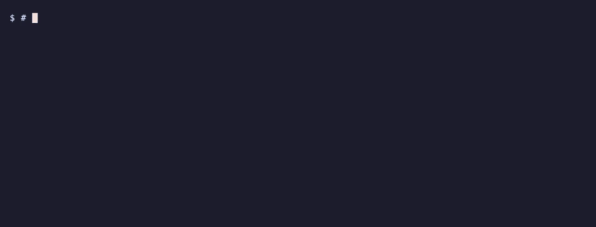

# Hinglish Intake

**Turn calls, voice notes and screen recordings in English, Hindi, Hinglish
and Marathi into speaker-labelled transcripts, screenshots and cited meeting
notes that Claude can read. Everything runs on your Mac.**



<sub>A fictional call made with macOS voices, transcribed on a base M4. The wait is shown at 6× speed. Try it yourself with
`bin/ingest.sh docs/team-call.mp3 --speakers 2`. How the demo was made: [docs/DEMO.md](docs/DEMO.md).</sub>

Claude can't open a video or audio file. Most speech-to-text tools also do
badly on Indian business calls: people switch between Hindi and English
mid-sentence, Marathi comes out as Hindi, Whisper makes up text during
silence, and nobody's name is spelled right. Hinglish Intake solves those
problems locally, on Apple Silicon, so recordings never leave the machine:

- **Mixed-language transcripts.** Each stretch of speech goes to the model
  for its language: [Tara](https://huggingface.co/Trelis/tara) for
  English/Hindi/Hinglish (English stays in Latin script, Hindi in
  Devanagari), and AI4Bharat IndicWhisper for Marathi. Languages can be mixed
  freely within a file.
- **Who said what.** Speaker diarization runs alongside transcription.
  Enrolled colleagues are labelled by name (`Asha:`) instead of `S1:`, and
  you can enrol them from Google Meet captions.
- **What was on screen.** For videos, it takes one screenshot per scene and
  reads the on-screen text (macOS Vision). A timeline joins each screenshot
  to what was said while it showed (`timeline.md`, `evidence.pdf`).
- **Notes you can check.** Claude Code writes a summary, decisions, action
  items with owners, and open questions. Every point cites `[file @ mm:ss]`.
  If Claude is unavailable, a local Gemma model writes a draft.
- **Optional team mode.** Teammates upload recordings through a free static
  Hugging Face Space, a Mac worker processes them, and the results come back
  as a folder with a `CLAUDE.md` and skills (`/meeting-notes`, `/decisions`,
  `/actions`, `/search`).

A 22-minute Hinglish call with three speakers takes about 2 minutes on an M4
Pro (10.5× realtime, 3.9 GB peak memory). The model comparison and its
numbers are in [`eval/REPORT.md`](eval/REPORT.md).

## Requirements

- macOS on Apple Silicon (M1 or later). It uses MLX, and macOS Vision for OCR.
- 16 GB RAM is comfortable. The core models need about 3 GB of disk; all of them need about 20 GB.
- [Homebrew](https://brew.sh): `ffmpeg`, `uv`, optionally `whisper-cpp`.
- Xcode Command Line Tools (`xcode-select --install`) for on-screen text (`--ocr`).
- Optional: [Claude Code](https://claude.com/claude-code), logged in, for meeting notes.

## Install

```bash
git clone https://github.com/nishant-devekar/hinglish-intake && cd hinglish-intake
brew install ffmpeg uv
uv venv --python 3.12 .venv
uv pip install --python .venv/bin/python -r requirements.txt
bin/fetch_models.sh               # core models; add --marathi, --qwen3, --vibevoice, --notes-local or --all
```

Optional: add your team's names and jargon so the models spell them right.

```bash
cp config/hotwords.example.txt config/hotwords.txt          # one word per line
cp config/corrections.example.tsv config/corrections.tsv    # regex<TAB>fix for misheard names
```

`config/` is gitignored, so your names stay on your machine.

## Use

```bash
bin/ingest.sh call.mp3 --speakers 3          # known head-count = better speaker labels
bin/ingest.sh demo.mp4 --ocr                 # video: screenshots per scene + on-screen text
.venv/bin/python bin/transcribe.py call.mp3 --out out/call    # audio only
```

Output lands in `out/<name>/`:

| file | what |
|---|---|
| `transcript.txt` | `[mm:ss] Asha: ...` speaker-labelled speech |
| `transcript.srt` / `.json` | the same, for players / for code (exact times and each line's language) |
| `frames/frame-0001.jpg` … | one screenshot per scene; `index.txt` maps frames to time spans |
| `frames/ocr.txt` | on-screen text per frame (`--ocr`) |
| `timeline.md` / `.json` | who spoke how long, then scene by scene: screenshot, on-screen text, what was said |
| `evidence.pdf` | the timeline with screenshots embedded, to attach in claude.ai |
| `audio.wav` | 16 kHz mono, loudness-normalised (what the model heard) |

Meeting notes (`notes.md`, written by Claude Code with citations) come from
the job pipeline: `bin/process.py <job_dir>` on a folder with `job.json`
and `input/` (create one with `LocalStore("store").create_job(...)` from
`bin/store.py`), or the worker in team mode below.

## Speech engines (`--engine`)

| engine | use for |
|---|---|
| `auto` (default) | Any mix of English, Hindi/Hinglish and Marathi. Each speech unit goes to Tara. Units that VoxLingua107 hears as Marathi, and that Tara writes mostly in Devanagari, are redone by the Marathi model. Without `--marathi` models, everything goes to Tara. |
| `tara` | Hinglish calls and voice notes. Verbatim: English in Latin script, Hindi in Devanagari. Runs on MLX. |
| `tara-torch` | Same model on PyTorch/MPS, as a fallback. |
| `marathi` | Marathi calls (AI4Bharat IndicWhisper, Whisper-medium fine-tuned on Marathi). |
| `qwen3` | A second opinion, or mostly-English audio. Punctuated, and doesn't make up text during silence. |
| `vibevoice` | Long meetings where *who said what* matters more than exact wording. |
| `whisper` | Fallback that needs no Python (whisper.cpp + Silero VAD). |

Every engine except `vibevoice` runs behind voice-activity detection and
speaker diarization. `--speakers N` sets the speaker count, and the
pipeline trusts it as given.

## Speaker names

```bash
.venv/bin/python bin/voices.py enroll-srt call.mp3 meet-captions.srt   # everyone named in Meet captions
.venv/bin/python bin/voices.py enroll-from out/some-call S2 Asha       # "S2 in that call was Asha"
.venv/bin/python bin/voices.py enroll Asha clip.mp3 01:10-01:40
.venv/bin/python bin/voices.py list
```

Each enrolment adds to that person's voice print, so labels get more
reliable with every call. Prints (`voices/prints.json`) are voice
biometrics: they stay on your machine, are gitignored, and are only used to
label your own recordings. Get consent from the people you enrol.
`--no-names` turns naming off.

## Team mode (optional, free)

```
teammate ──upload──▶ static HF Space (free)  ──▶  private HF dataset  ◀──poll──  your Mac (worker)
teammate ◀──results── Space / hf download   ◀──  jobs/<id>/result/  ◀──push──  transcripts, frames, notes
```

```bash
.venv/bin/hf auth login                         # account with write access to <org>
.venv/bin/python deploy/setup_hf.py <org>       # creates <org>/intake (dataset) and <org>/intake-app (Space)
deploy/install_worker.sh <org>/intake           # run the worker as a login service on this Mac
```

Teammates sign in to the Space with their own Hugging Face accounts. No
token is stored in it. Each job gets back `notes.md`, the transcripts,
frames, audio and `bundle.md` (everything in one file for claude.ai). The
dataset root holds `CLAUDE.md` and skills, so `hf download` followed by
`claude` gives you a workspace ready to query: *"what did Asha decide about
pricing this week?"*, `/actions Ravi`. Static Spaces are free for
organizations; the worker keeps the dataset small by moving processed
uploads to `archive/` on the Mac.

To try it locally without Hugging Face, use `bin/store.py`'s `LocalStore`
with `bin/worker.py store`.

## Evaluation

[`eval/REPORT.md`](eval/REPORT.md) explains why the pipeline looks the way
it does. It covers loudness normalisation, VAD against made-up text during
silence, Tara vs Qwen3 vs VibeVoice vs whisper.cpp on Hinglish, speaker
embedding comparisons, language routing for Marathi, and MLX decoding speed.
To rerun the comparisons on your own recordings:

```bash
eval/run_whisper_cpp.sh
.venv/bin/python eval/run_models.py tara qwen3 vibevoice
.venv/bin/python eval/score.py
```

[`eval/gold/README.md`](eval/gold/README.md) explains how to make a
hand-corrected reference transcript for real WER/CER numbers.

## Models and licenses

The code is [Apache-2.0](LICENSE). The models are downloaded separately by
`bin/fetch_models.sh`, and each has its own license:

| model | license |
|---|---|
| [Trelis/tara](https://huggingface.co/Trelis/tara) (Whisper-large-v3, Hinglish) | Apache-2.0 |
| AI4Bharat IndicWhisper Marathi | MIT |
| [speechbrain/lang-id-voxlingua107-ecapa](https://huggingface.co/speechbrain/lang-id-voxlingua107-ecapa) | Apache-2.0 |
| [mlx-community/Qwen3-ASR-1.7B-8bit](https://huggingface.co/mlx-community/Qwen3-ASR-1.7B-8bit) | Apache-2.0 |
| [mlx-community/VibeVoice-ASR-4bit](https://huggingface.co/mlx-community/VibeVoice-ASR-4bit) | MIT |
| [mlx-community/gemma-4-12B-it-4bit](https://huggingface.co/mlx-community/gemma-4-12B-it-4bit) | Apache-2.0 |
| pyannote segmentation-3.0, NeMo TitaNet-large, Silero VAD ([sherpa-onnx](https://github.com/k2-fsa/sherpa-onnx) builds) | MIT / CC-BY-4.0 / MIT |

## Contributing

Issues and pull requests are welcome, especially for other Indian languages
(Tamil, Telugu, Bengali, Gujarati…), Linux/CUDA support, and gold
transcripts. See [CONTRIBUTING.md](CONTRIBUTING.md).
